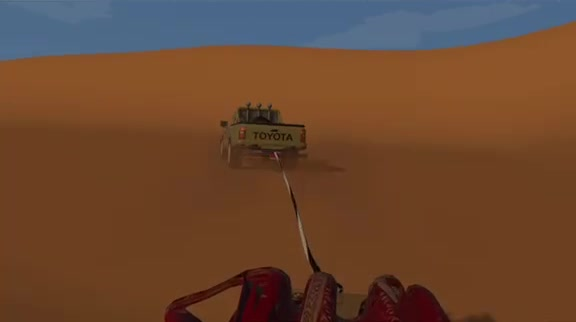
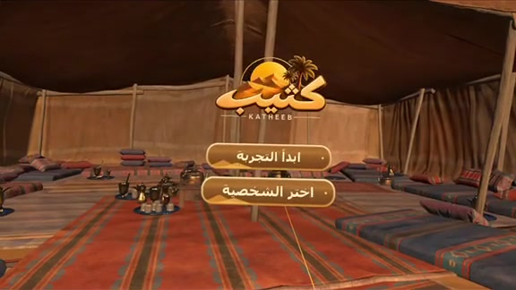
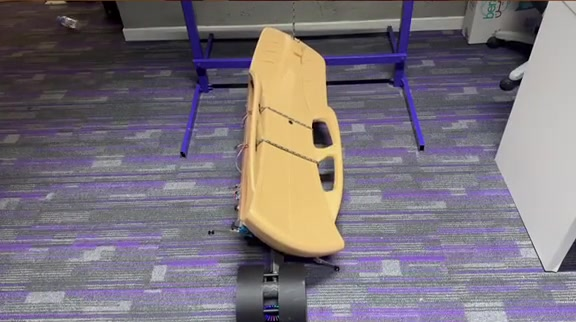

<div align="center">

# KATHEEB · كثيب
### VR Sled Motion Simulator

An immersive VR desert sled ride built in **Unity** for **Meta Quest 3**, connected to a **physical sled**
that tilts in real time with the ride.

Built for the **Expo 2030 Immersive Challenge** · Tuwaiq Academy & Misk Skills · 2026



</div>

---

## The experience

| Start in a Bedouin tent | Ride across the dunes | Feel it on the physical sled |
| --- | --- | --- |
|  |  |  |

1. The experience opens in a traditional **Bedouin tent**, where you start the ride or choose a character (Arabic menu).
2. A pickup truck **tows the sled by rope** across a desert landscape inspired by the Thumamah area near Riyadh, with turns and terrain bumps.
3. The sled's motion is streamed to an **ESP32**, which moves the **physical sled** in sync with what you see.

## How the hardware link works

```
Unity (Meta Quest 3) ──WebSocket──▶ ESP32 (ws://192.168.4.1:8080) ──▶ physical sled
                     "roll,bump"  ×20 per second
```

| Signal | Range | Meaning |
| --- | --- | --- |
| `roll` | −10 … +10 | left turn … straight (0) … right turn |
| `bump` | 0 … 10 | strength of the terrain bump |

Main scripts:

- `SledMotionController.cs`: sled roll and bump physics from the route and terrain
- `HardwareOutput.cs` / `HardwareSignalFormat.cs`: turn that motion into the two signals above
- `WebsocketSender.cs`: sends them to the ESP32 and reconnects automatically
- `CarPathFollower.cs`, `TowRopeSimulation.cs`, `RouteTerrainBumps.cs`: the towing vehicle, rope and terrain
- `KatheebMenu/`: the VR menu and character selection

## Tech

Unity 6 (6000.6.3f1) · C# · OpenXR · XR Interaction Toolkit · XR Hands · Meta Quest 3 · ESP32 · WebSocket (NativeWebSocket)

## Running it

1. Open the project in **Unity 6000.6.3f1**.
2. Open `Assets/Scenes/Demo.unity`.
3. Power the ESP32 sled controller and connect the headset to its Wi-Fi access point (`192.168.4.1`).
4. Build to Meta Quest 3 and press **Start** in the tent.

The ride also runs without the hardware connected; the app keeps retrying the connection in the background.

---

<sub>Team project. Portfolio: <a href="https://github.com/ramaalsaabb-cmd/Claude">Rama Alsaab</a></sub>
